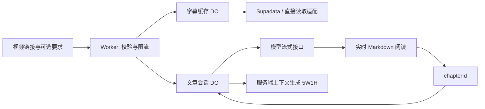

# 架构与代码走读

## 模块与走读顺序

| 顺序 | 文件                                                 | 职责                               |
| ---- | ---------------------------------------------------- | ---------------------------------- |
| 1    | `src/shared.ts`                                      | 来源、文章、结构化总结与流事件契约 |
| 2    | `src/client/SourcePanel.tsx`、`useWorkbench.ts`      | 输入、增量展示、取消、恢复与导出   |
| 3    | `src/server/index.ts`                                | 同源、访问码、请求边界与路由       |
| 4    | `src/server/transcript.ts`、`TranscriptCache.ts`     | 素材入口、每视频缓存、并发合并     |
| 5    | `src/server/supadata.ts`、`youtube.ts`               | 网络适配、错误、来源和时间轴       |
| 6    | `src/server/session/ArticleSession.ts`               | 会话生命周期、流式检查点、持久化   |
| 7    | `src/server/ai.ts`、`src/protocol/sse.ts`            | Gemini/智谱流式协议与完成状态      |
| 8    | `src/domain`、`session/ensure-evidence.ts`           | 字幕、章节要求与引用边界           |
| 9    | `session/summarize.ts`、`client/hooks/useSummary.ts` | 只传章节ID的5W1H与缓存             |
| 10   | `client/hooks/useEvidence.ts`、`SourceEvidence.tsx`  | 搜索、引用定位、时间跳转           |

## 工程判断

- 同一 Worker 提供前端和 API；SQLite Durable Objects 保存24小时文章与字幕缓存，没有引入账号平台或通用任务系统。字幕服务密钥仅发送到固定服务端点。
- 每视频字幕请求合并，成功结果缓存24小时，失败不缓存；新文章保存自己的来源副本，缓存更新不改变旧文章。用户取消不会撤销其他会话共用的字幕读取，继续生成前会检查取消。
- 主文章是真流式输出，连接提前中断不能冒充成功。中断会保存部分正文，只有结构和引用校验通过才标为完成。
- 模型偶尔忽略精确章节数，使用纯函数重组已有段落；缺失引用一次批量请求结构化补全，最多24段，并校验输入段落与返回结果一一对应，不以伪造编号掩盖失败。
- 服务端保留完整来源与章节上下文，5W1H 不依赖前端重传正文。同章并发合并，未提到的信息明确为空；引用编号存在不等于语义已自动证明。
- ASR 与媒体服务已从交付版本移除，保留原文核对。Gemini适配保留，但真实验收目前使用智谱；模型差异必须说明。
