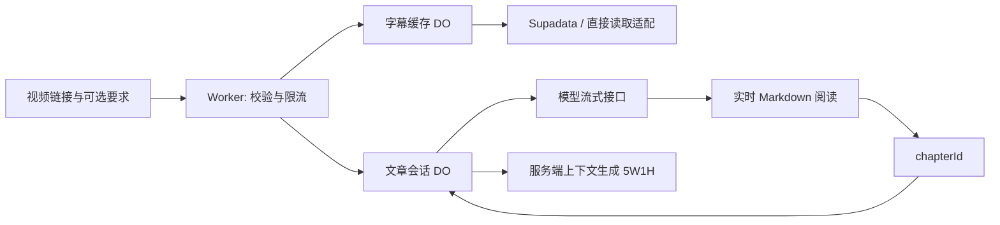

# 架构与代码走读

## 模块与走读顺序

| 顺序 | 文件                                                 | 职责                                   |
| ---- | ---------------------------------------------------- | -------------------------------------- |
| 1    | `src/shared.ts`                                      | 来源、文章、结构化总结与流事件契约     |
| 2    | `src/client/SourcePanel.tsx`、`useWorkbench.ts`      | 输入、增量展示、取消、恢复与导出       |
| 3    | `src/server/index.ts`                                | 同源、访问码、请求边界与路由           |
| 4    | `src/server/transcript.ts`、`TranscriptCache.ts`     | 素材入口、每视频缓存、并发合并         |
| 5    | `src/server/supadata.ts`、`youtube.ts`               | 网络适配、错误、来源和时间轴           |
| 6    | `src/server/session/ArticleSession.ts`               | 会话生命周期、流式检查点、持久化       |
| 7    | `src/server/ai.ts`、`src/protocol`                   | Gemini/DeepSeek/智谱流式协议与完成状态 |
| 8    | `src/domain`、`session/ensure-evidence.ts`           | 字幕、章节要求与引用边界               |
| 9    | `session/summarize.ts`、`client/hooks/useSummary.ts` | 只传章节ID的5W1H与缓存                 |
| 10   | `client/hooks/useEvidence.ts`、`SourceEvidence.tsx`  | 搜索、引用定位、时间跳转               |

## 工程判断

- 同一 Worker 提供前端和 API；SQLite Durable Objects 保存24小时文章与字幕缓存，没有引入账号平台或通用任务系统。字幕服务密钥仅发送到固定服务端点。
- 每视频字幕请求合并，成功结果缓存24小时，失败不缓存；新文章保存自己的来源副本，缓存更新不改变旧文章。用户取消不会撤销其他会话共用的字幕读取，继续生成前会检查取消。
- 主文章是真流式输出，连接提前中断不能冒充成功。中断会保存部分正文，只有结构和引用校验通过才标为完成。
- 模型偶尔忽略精确章节数，使用纯函数重组已有段落；缺失引用一次批量请求结构化补全，最多24段，并校验输入段落与返回结果一一对应，不以伪造编号掩盖失败。
- 服务端保留完整来源与章节上下文，5W1H 不依赖前端重传正文。同章并发合并，未提到的信息明确为空；引用编号存在不等于语义已自动证明。
- ASR 与媒体服务已从交付版本移除，保留原文核对。当前驱动使用DeepSeek；Gemini普通Flash已升级Interactions接口，短请求流式可用，但完整视频验收受503阻塞，未作为默认。智谱接入保留。

## 篇幅控制

`domain/length.ts` 解析明确的总篇幅、合并上下限并拒绝冲突；与界面共用 `requirements.readableLength` 统计。`session/fit-length.ts` 负责最多三轮编辑，将真实字数差反馈给模型、校准内部写作预算，由程序保留原标题，并验证章节结构/顺序对应的引用、讲者及原有引用。编辑只基于初稿，不能引入新事实或引用编号；语义仍须人工核对。

小幅超限可以通过整段省略可选导语解决，不能裁掉正文句子或开场讲者发言。用户要求保留导语时不删除。失败不覆盖初稿，不标记完成；最后在引用补全后再次校验总字数。未指定明确总篇幅的请求保持原流程。篇幅调整通过独立模块处理，模型厂商切换复用同一套验收。

## 建议的实际走读方法

先在网页完成一次“视频 → 四章节文章 → 章节5W1H → 原文定位”，再按下面两条请求路线读。第一遍只跟数据流，第二遍再看异常、并发和测试；不必从样式或全部提示词开始。

### 第一条：生成文章

1. **边界与契约**：先看 `wrangler.jsonc` 和 `src/shared.ts`。区分每视频共享的 `TRANSCRIPTS`、每文章独立的 `SESSIONS`、按IP限频的 `QUOTAS`；认识 `Source`、`Article`、`Chapter`、`GenerationEvent`。24小时数据在云端保存，浏览器历史只存索引。
2. **用户点击生成**：在 `src/client/useWorkbench.ts` 找 `start()`，确认请求只含来源和用户要求；再跳到 `src/server/index.ts` 的 `/api/generate`。看输入验证、同源检查、访问码、限频和随机会话ID如何先于模型调用执行。
3. **素材如何来**：沿 `src/server/transcript.ts:getSource()` → `TranscriptCache.ts:resolve()` → `supadata.ts` 读。观察缓存键、24小时过期、同视频并发合并、失败不缓存，以及毫秒时间轴如何归一化。`youtube.ts` 是未配置Supadata时的备选入口，可第二遍再看。
4. **生成主干**：回到 `src/server/session/ArticleSession.ts:stream()`。依次跟随读取字幕、保存来源、流式写初稿、整理章节、验收篇幅、补全引用、最终保存与完成事件。注意只有最后验证通过才能变成 `complete`；取消和错误进入 `interrupted`，不丢弃初稿。
5. **为什么是真流式**：读 `src/server/ai.ts:generate()` → `src/protocol/gemini.ts:readGemini()` / `src/protocol/sse.ts:readSSE()`，再回 `useWorkbench.ts` 的事件循环。模型增量经Worker的 `delta` 到浏览器；`done.markdown` 负责替换为最终通过验收的正文。读结束标记检查，理解网络断流为什么不能算成功。`server/model-request.ts` 只对尚未输出的Gemini 503做最多三次请求，遵守Retry-After，开始输出后不自动重播；`model-error.ts` 区分日额度耗尽、零免费额度和一般限流，避免泄漏上游详情。
6. **模型之外的确定性规则**：读 `domain/length.ts`、`domain/requirements.ts`、`domain/outline.ts`、`session/fit-length.ts`、`session/ensure-evidence.ts`。分别回答“字数如何计”“章节不符怎么办”“编辑最多几轮”“怎样保护标题、讲者与引用”“失败时留下哪一版”。编号存在性可验证，语义正确性仍需人工核对。
7. **最后看展示**：`ArticleReader.tsx` → `Markdown.tsx` → `SourceEvidence.tsx` / `hooks/useEvidence.ts`。关注DOMPurify清洗、原文链接拦截、字幕搜索与真实时间跳转；样式最后阅读。

### 第二条：章节5W1H

从 `src/client/hooks/useSummary.ts:openSummary()` 出发，确认请求体只有 `{ chapterId }`；跟到 `ArticleSession.ts:summary()`，看它如何找到服务端保存的文章和章节、复用缓存、合并并发请求；再读 `session/summarize.ts` 与 `domain/evidence.ts:validateCitedSummary()`，确认完整字幕和当前章节参与生成，六个字段、信息缺失状态和引用都有校验。最后看 `SummaryDialog.tsx` 如何展示。

### 用测试反问设计

- `tests/core.test.ts`：中文跨分片、结束标记、提前断流，为什么不能用普通字符串切分SSE？
- `tests/transcript-cache.test.ts`：同一视频两个用户同时生成，怎样避免重复扣字幕额度？
- `tests/length.test.ts` / `fit-length.test.ts`：怎样区分全文与每章字数要求？编辑失败为什么不能假报完成？
- `tests/ensure-evidence.test.ts` / `evidence.test.ts`：哪些引用问题可由程序检查，哪些仍不能自动证明？
- `tests/providers.test.ts` / `gemini.test.ts`：切模型时如何保证密钥只发送给对应厂商？怎样忽略思考与签名、确认真实结束、取消退避，避免重播部分正文？
- `tests/smoke.mjs`：停止、保留部分正文、禁止总结未完成文章、删除后404如何在真实HTTP链路验收？

走读完成后，应能画出两条请求路线，并解释三个取舍：为什么采用按会话持久化、为什么不把完整正文从前端重传、为什么把事实与字数校验放在“完成”之前。详细测试结果见 [VALIDATION](VALIDATION.md)。
