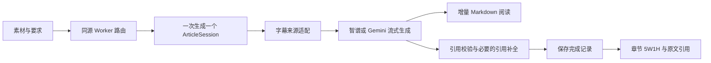
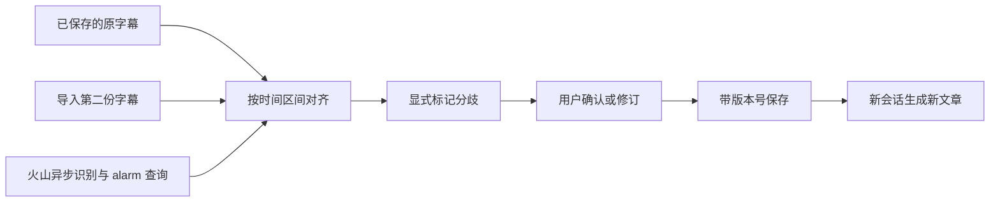

# 架构与代码走读

## 两条核心链路

## 模块职责

| 模块                                | 职责                                              |
| ----------------------------------- | ------------------------------------------------- |
| `domain/captions.ts`                | SRT/VTT解析、时间轴与长度校验、引用编号           |
| `domain/evidence.ts`                | 引用解析、引用存在性校验、5W1H结构化契约          |
| `domain/outline.ts`                 | 按明确章节数量重新分组，保留原有正文与引用        |
| `domain/comparison.ts`              | 按区间连接分组、一对多对齐、人工确认规则          |
| `server/index.ts`                   | 同源检查、访问码、输入边界、路由分发              |
| `server/transcript.ts`              | 素材入口与 YouTube 获取                           |
| `server/TranscriptCache.ts`         | 每视频的24小时持久缓存、并发合并与过期清理        |
| `server/supadata.ts`                | 只读取已有字幕的服务适配、时间单位与错误边界      |
| `server/ai.ts`                      | 模型协议适配与提示词，不承载会话状态              |
| `server/session/ArticleSession.ts`  | 会话持久化、生成生命周期、过期与调度              |
| `server/media-gateway.ts`           | 独立音频存储的鉴权HTTP适配与返回地址验证          |
| `services/media-gateway/server.mjs` | 有容量上限的临时文件、签名下载、Range与过期回收   |
| `server/session/audio.ts`           | 有大小与时效限制的音轨、令牌下载、Range回听与清理 |
| `server/youtube.ts`                 | YouTube协议边界、读取实际选择的字幕轨道类型       |
| `server/session/ensure-evidence.ts` | 文章引用核对，只补引用，不重写正文                |
| `server/session/summarize.ts`       | 章节总结的上下文与引用契约                        |
| `server/session/reviews.ts`         | 校对版本、识别状态、已确认来源导出                |
| `server/recognition.ts`             | 火山 submit/query HTTP 协议与错误转换             |
| `client/useWorkbench.ts`            | 输入、生成、最近记录与导出编排                    |
| `client/hooks`                      | 摘要、原文与校对、移动面板各自的状态生命周期      |
| `client/Markdown.tsx`               | 清洗 HTML，拦截原文锚点                           |
| 阅读、素材、总结、原文面板组件      | 展示与交互，领域计算不放在组件中                  |

## 工程判断

### 可核对的引用，不制造准确率

模型使用服务端分配的字幕编号，时间跳转由真实 cue 计算。总结中的引用必须存在；未提到的字段必须明确为空，不接受推测性文案。服务器不声称证明了引用与结论之间的语义正确性，仍提供原文供人工核对。

当初次生成遗漏了段落引用，按缺失段落请求结构化引用核对（最多8段，每段一次）：模型选择支持该段的真实编号，不允许改写正文或随意补编号。无法找到支持内容、编号无效或请求失败时保留文章为中断状态。引用补全不是自动重生成整篇文章。

明确的章节数量由纯函数处理：重组既有章节和段落，保留原小标题，不再调用模型重写全文。篇幅和语言风格仍由模型遵循。

### 字幕获取与缓存

字幕缓存使用独立 SQLite Durable Object，以服务和视频编号分区。首次成功结果保存24小时，命中时保留真实读取时间及来源；同视频并发合并。失败不写入缓存。配置 Supadata 时固定 `mode=native`，不自动触发 ASR；未配置时保留直接获取适配器。API密钥只发送到固定服务端点，读取视频标题的公开 oEmbed 请求不携带密钥。删除文章不影响公开字幕的共享缓存，缓存自身按期删除。

一次取消不撤销其他会话共用的字幕读取，读取本身受超时限制；调用方在继续生成前检查取消。现有会话使用自身保存的来源，缓存刷新不改变旧文章。来源适配成功与服务可用性是两项不同验收，真实服务的样本与结果见 `VALIDATION.md`，协议测试不代替服务可用性验证。

### 稳定的来源版本

文章生成使用的字幕在该会话内不变。校对内容放在单独记录，采用乐观版本检查防止覆盖旧修改。只有所有分歧明确确认才导出修订来源，并创建新的文章会话，因此旧文章与总结缓存始终对应旧来源。

### 异步识别与应用取消的边界

火山任务 ID 与状态先持久化，再请求服务。Durable Object alarm 定期查询，关闭网页不会丢任务；查询不会依赖浏览器传回完整字幕。停止等待只停止本应用轮询，不能保证服务商撤销任务。

### 上传与回听

线上配置独立`media-gateway`：Cloudflare验证上传后把文件发送到mxc-new，服务返回1小时有效的HMAC下载链接，浏览器与火山直接下载。Durable Object只存音频元数据；服务密钥始终在服务端。无网关配置时保留本地会话存储模式。服务器独立目录、systemd服务与TLS证书，不为上传开启公共写入。详见`deploy/media-gateway/README.md`。

每篇文章最多一份24 MB音轨，1小时后失效；删除文章同时删除音轨。下载使用独立随机令牌，仅允许GET/HEAD，并支持单段Range以便回听。写入时验证文件签名、大小、文章存活和识别状态；识别处理中不允许替换音轨。与文章分开存储分块音频，事务更换与过期清理，不把音频塞进文章JSON或模型上下文。

无媒体网关配置的本地模式复用SQLite Durable Object；线上临时音轨独立存放于mxc-new。较大文件、转码和长期保留应迁移到专门的媒体处理与存储服务。SQLite DO的单值大小限制与存储语义见[官方限制](https://developers.cloudflare.com/durable-objects/platform/limits/)及[存储接口](https://developers.cloudflare.com/durable-objects/api/legacy-kv-storage-api/)。本地 `dev:asr` 通过只允许音频路径的中继连接[Quick Tunnel](https://developers.cloudflare.com/tunnel/get-started/quick-tunnels/)，不把本地开发管理界面暴露出去。

### 控制复杂度

前后端同一个 Worker、SQLite-backed Durable Objects 保存24小时会话，没有引入通用任务平台、账号系统或额外数据库。字幕解析与对齐是无副作用的纯函数；有网络副作用的 ASR 与模型调用各自封装。不会为了演示增加未使用的架构层。

### 成本与延迟

只有用户请求某一章时才生成5W1H，并缓存及合并同章并发。字幕校对由用户选择开启，不会对每个视频强制调用ASR。生成保留真实流式输出，引用核对独立显示状态。输入、输出、并发和生成频率都有边界；外部服务的耗时和成本仍由各自账户决定。

## 建议走读顺序

1. `shared.ts` 看数据契约。
2. `main.tsx`、`SourcePanel.tsx` 看用户入口。
3. `useWorkbench.ts` 的 `start` 看请求与增量状态。
4. `server/index.ts`、`ArticleSession.stream` 看生命周期。
5. `transcript.ts`、`TranscriptCache.ts`、`supadata.ts` 看字幕获取；`ai.ts`、`protocol/sse.ts` 看模型边界。
6. `ensure-evidence.ts`、`summarize.ts` 看证据约束。
7. `comparison.ts`、`reviews.ts`、`recognition.ts` 看校对与异步任务。
8. `useEvidence.ts` 和对应界面看用户如何核对与修订。
9. `tests` 与验证报告看哪些结论有测试支持，哪些仍有限制。
